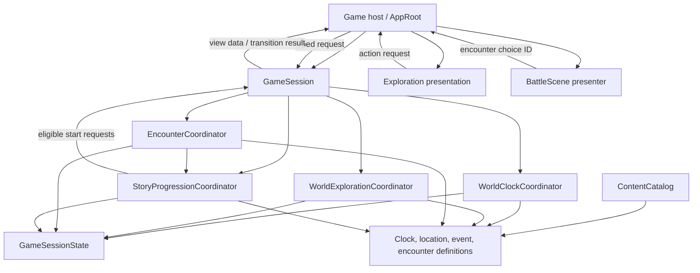
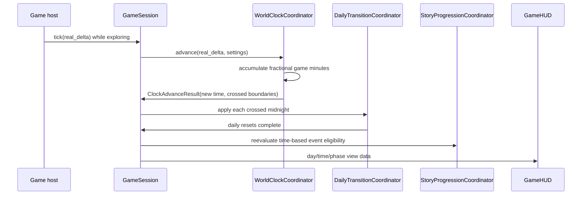

# World Clock and Outcome-Based Encounter Progression

**Date:** 2026-10-03  
**Status:** Design for review  
**Project:** Miswell Godot prototype

## Purpose

Replace Miswell's fixed morning/afternoon/evening schedule with a continuous world clock, and establish the boundaries for choice-driven encounters whose resolved outcomes can shape later events, days, and life stages.

The design preserves the existing layered structure: Godot scenes present state and send requests; application coordinators sequence game operations; domain state and rules own the authoritative outcomes; infrastructure loads authored definitions. The playthrough session remains the owner of its state.

## Current implementation

- `GameState` stores `day_number`, a three-entry `day_schedule`, activity IDs visited today, and family-specific outcome flags.
- `DayLoopCoordinator` books activities into fixed slots, formats a schedule, and manually finishes the day. It ends the prototype after Day 3.
- `AppRoot` asks for a slot before resolving a location or family interaction. Returning home ends the day.
- `GameHUD` renders a slot strip and a slot-picker panel. It also renders the existing dialogue choices in a modal panel.
- `WorldExplorationCoordinator` resolves location effects, while `DialogueEncounterCoordinator` handles the family conversation and writes its consequences directly to family fields in `GameState`.
- `GameSession` composes the current application coordinators.

The shared repository also has concurrent map, UI, and asset edits in progress. Those changes are outside this feature's file scope and must remain untouched by its implementation and commits.

## Goals

1. Advance in-game time continuously during free exploration, including across night and midnight.
2. Show only a compact day/time/day-or-night indication. Night has no special world rendering or gameplay rules in this feature.
3. Resolve a location action when the player interacts with it; remove the time-slot selection and booking flow.
4. Pause world time while an encounter or another blocking panel is active.
5. Present encounters in a separate battle scene, while keeping encounter rules and story effects outside scene nodes.
6. Route player-initiated and NPC/event-initiated encounters through one application boundary.
7. Record completed outcomes so later rules can inspect which event produced which outcome.
8. Let an optional event's availability window close without writing a missed-event record or creating an implicit negative story fact.
9. Keep content and state keyed by stable IDs so definitions and state can later be saved, tuned, and tested independently of scenes.

## Non-goals

- Night-time movement restrictions, lighting changes, sleep, waking, or overnight consequences.
- A polished battle interface, combat animation, damage model, or battle-specific art. The first scene is a structural presenter for the existing choice-based encounter.
- A universal event bus, arbitrary script callbacks in authored content, or a full quest scripting language.
- Save-slot implementation. Session state should remain serializable by design, but persistence is a separate feature.
- Expanding the current story content beyond migrating the family encounter and its existing follow-up behavior.

## Decisions

### World clock

- Initial game time: **Day 1, 08:00**.
- Progression rate: **2 in-game minutes per real second**.
- Day indicator: **Day** from 06:00 inclusive to 20:00 exclusive; **Night** otherwise.
- The clock continues while the player explores at night. Day number increments at midnight, minute-of-day wraps to 00:00, and the new day continues without a sleep action.
- The clock rate and day/night boundaries are values in a `GameClockSettings` resource, not UI or scene constants.
- The HUD displays a compact value such as `Day 1 · 08:00 · Day`. It does not change world colors or map appearance.
- The clock only advances in the exploration simulation mode. Encounter presentation and blocking message/menu panels stop it. Returning to exploration resumes from the same in-game minute.
- The current anxiety effect remains a real-time exploration timer for this feature; it is paused whenever exploration is paused. It is separate from the world clock's game-minute rate.

### Actions and daily transition

- A location interaction resolves immediately through the exploration application service. It does not reserve a future time.
- Preserve the current once-per-day restriction for each location/activity ID; clear its daily usage state at midnight.
- Remove slot IDs, available-slot restrictions, schedule booking, and schedule summaries from the gameplay path.
- Home no longer forces midnight. Sleep and time-skipping at home remain future design work.
- Remove the fixed Day 3 stop from the clock loop. A future story ending or life-stage transition must be an explicit story rule, not a hard-coded clock limit.
- Preserve the existing day-transition anxiety cleanup when midnight occurs: reduce anxiety by 12 points, clear its temporary effect, and reset its timer. Keep family-specific consequences in story outcome effects rather than in a generic day reset.
- Do not apply the current family trust penalty or a later family follow-up consequence merely because the Day 1 optional encounter did not resolve. The Day 2 follow-up checks a completed Day 1 outcome when one exists; without that outcome, the optional event's absence has no story effect.

### Story outcomes and optional events

- The outcome journal records only resolved events. A record contains stable `event_id`, `outcome_id`, and the in-game `day_number` and `minute_of_day` when it resolved; additional provenance can be added when a concrete feature needs it.
- Each completed outcome applies its declared effects to current story facts and game values in the same application operation that appends its outcome record.
- A future event condition may query completed outcomes, current facts, current day/time, or an explicitly modeled life stage.
- An optional event window controls eligibility. When its time or other condition expires, the event is no longer eligible. No `missed` journal entry or implicit negative fact is created.
- Absence of an outcome means only that no resolved outcome exists. Future content must explicitly require a completed outcome or a fact produced by one; missing history is not interpreted as failure.
- Event definitions declare whether a start comes from player interaction or a scripted NPC/world trigger. Both routes use the shared encounter request.

## Architecture

### Ownership and layers

`GameSession` composes application coordinators and owns the playthrough state. The host controls which presentation is visible and forwards typed requests. Application code owns sequencing and validation. Domain data uses IDs and values; it holds no `Node`, `Control`, `PackedScene`, or live actor reference.

### Component responsibilities

| Component | Layer | Responsibility |
| --- | --- | --- |
| `GameSessionState` | Domain | Authoritative day/time, daily action usage, active encounter data, story facts, current relationship values, and completed outcome journal. Contains serializable IDs and values only. |
| `GameClockRules` | Domain | Normalize a minute-of-day, determine day/night from settings, and calculate every crossed midnight/boundary for an elapsed-time update. Pure logic with no frame loop. |
| `GameClockSettings` | Domain/content | Configure start time, rate, and day/night boundaries. Initial values are 08:00, 2 game minutes per real second, 06:00, and 20:00. |
| `WorldClockCoordinator` | Application | Accumulate fractional game minutes from real frame delta, update time state, and report minute/day transitions. |
| `DailyTransitionCoordinator` | Application | Apply once-per-day resets and existing daily anxiety cleanup on each midnight. Does not decide story outcomes. |
| `WorldExplorationCoordinator` | Application | Validate and resolve an immediate location action, enforce once-per-day use, and apply the location's declared effects. |
| `EncounterCoordinator` | Application | Validate a start request, load its definition, own the active encounter/turn state, return available choices, and resolve selected choices. |
| `StoryProgressionCoordinator` | Application | Check event eligibility, apply a resolved event's declared effects once, append its outcome record, and answer queries used by later event conditions. Does not persist missed-event records. |
| `ContentCatalog` | Infrastructure | Load location, encounter, story-event, and clock settings resources by stable ID. |
| `AppRoot` / game host | Presentation orchestration | Submit session ticks only while exploration is active, route location/NPC input to application requests, show exploration or battle presentation, and pause the simulation during blocking UI. Does not apply effects. |
| `GameHUD` | Presentation | Replace the slot strip with the day/time/day-or-night indicator. Remove slot picker UI. Keep unrelated anxiety/trust indicators as needed. |
| `BattleScene` / `BattlePresenter` | Presentation | Place the player presentation along the bottom, its response options immediately below, and the opposing participant in the upper-right area. Render current choices and emit choice IDs. Does not inspect story history or mutate game state. |

`GameSession` replaces the current `GameState` plus `DayLoopCoordinator` composition with `GameSessionState`, `WorldClockCoordinator`, `DailyTransitionCoordinator`, and `StoryProgressionCoordinator`. The existing dialogue coordinator is generalized into `EncounterCoordinator`; family-specific presentation text and rules move behind the corresponding encounter definition/outcome effects rather than being written by the scene host.

### Time update and rollover

The fractional accumulator belongs to the coordinator, not the saved state. The persisted clock value is an integer day number plus integer minute-of-day. A large elapsed delta must process all crossed midnights in order, not increment the day at most once. If one update crosses multiple relevant boundaries, each transition is reported once and processed idempotently.

The host calls `GameSession.tick(real_delta)` only while the simulation mode is exploration. It does not call it while the battle scene or a blocking message/menu is active. A battle remains a pause in the same world session; it does not create a second clock or reset time on scene return.

### Interaction and encounter flow

#### Player-started encounter

1. The player interacts with a nearby NPC; the presentation host requests the event or encounter by ID.
2. `StoryProgressionCoordinator` checks the event's configured trigger source and current eligibility.
3. `EncounterCoordinator` creates the active encounter state and returns an encounter view.
4. The host presents `BattleScene` and stops world-clock ticks.
5. `BattlePresenter` emits a selected choice ID. `EncounterCoordinator` validates that the choice is still available and asks story progression to apply its declared outcome/effects.
6. If the encounter continues, the presenter receives the next view. If it resolves, the active encounter clears, the host returns to exploration, and the clock resumes unchanged.

#### NPC/world-started encounter

1. A time, story, or authored world trigger becomes eligible.
2. `GameSession.tick` returns a `SessionUpdate` containing typed start requests from `StoryProgressionCoordinator`; each request contains the event ID, encounter ID, and initiator/source ID.
3. The host submits the request to the same `EncounterCoordinator`, which validates and activates it; the host switches to `BattleScene`.
4. Resolution uses the same choice, outcome, and clock-pause path as a player-started encounter.

NPC actor scripts do not switch scenes, author story effects, or write outcome history. A focused coordinator result and request carry the transition; a global event bus is not introduced for the prototype.

#### Resolved outcomes

Each encounter choice maps to a declared `outcome_id` and an ordered set of typed effects, for example:

- `adjust_relationship(family, +1)`
- `set_story_fact(family_opportunity, preserved)`
- `add_story_fact(rumor_heard, school_news)`
- `mark_encounter_fact(family_good_news, supportive_response)`

The application validates the active event and allowed outcome, applies effects, and appends one `StoryOutcomeRecord`. This operation is idempotent for a resolved event so repeated callbacks or stale UI input cannot apply the same consequences twice. Each first-prototype event ID represents one resolvable occurrence; repeatable content can introduce distinct occurrence IDs when authored. Existing choice IDs and outcome IDs remain distinct: choice IDs are input options; outcome IDs name durable results that future conditions may query.

### Data model and event eligibility

- `GameSessionState.day_number: int` and `minute_of_day: int` are the only authoritative world-time values.
- `daily_action_ids` tracks location/activity actions already used in the current day.
- `active_encounter` contains the current event/encounter IDs, source, and turn/choice state, or is empty when no encounter is active.
- `story_facts` contains current named values required by future conditions, such as relationship levels or durable opportunity facts.
- `outcome_journal` is an ordered list of completed `StoryOutcomeRecord` values: `{event_id, outcome_id, day_number, minute_of_day}`.
- `StoryEventDefinition` contains a stable event ID, event/resolution kind, start policy, trigger source, eligibility conditions, optional opening/closing day-time bounds, and the applicable handler definition. Interactive events use an `EncounterDefinition`; other event handlers can be added when authored content needs them. The first implementation only needs the encounter kind.
- `EncounterDefinition` contains stable ID, participants, prompt/presentation data, and choices. The first migrated resource is the existing family encounter.
- Choice/outcome effects are authored declaratively as typed values; conditions query story facts, completed event outcomes, day/time, and a future life-stage value.

Event eligibility is computed from definitions and current session state. The prototype does not persist a `missed` status. Once a closing bound passes, the start check returns unavailable. No outcome record or story fact is written. A completed optional event produces its normal outcome record, which later conditions can query. This keeps optional absence neutral and prevents a missed event from silently becoming a negative consequence. Conditions about which event outcome occurred query the outcome journal; mutable or cumulative values such as relationship levels use current story facts.

Conditions should be a small serializable set (fact comparison, prior event outcome, day/time range, and conjunction/disjunction of these). Avoid embedding GDScript callbacks or arbitrary code in resources. Add condition types only when authored content needs them.

## Migration map

Expected implementation targets, subject to the implementation plan:

- `scripts/domain/game_state.gd`: replace schedule/family-specific control fields with session time, daily-use, active-encounter, story-fact, and outcome values.
- `scripts/application/day_loop_coordinator.gd`: replace fixed-slot planning/manual day finish with clock and daily-transition coordinators.
- `scripts/application/game_session.gd`: compose clock, daily transition, exploration, encounter, story progression, and content services.
- `scripts/application/world_exploration_coordinator.gd`: replace `visit_location(location_id, slot_index)` with an immediate action API.
- `scripts/application/dialogue_encounter_coordinator.gd`: generalize the application role into `EncounterCoordinator`; keep family-only branching in content/effect handlers rather than the host.
- `scripts/domain/location_definition.gd` and location `.tres` files: remove `available_slots`; retain action effects and prompts.
- Add domain definitions for clock settings, story event, story outcome/effect, and any small typed conditions needed by the first encounter.
- `scripts/infrastructure/content_catalog.gd`: expose definitions by stable IDs.
- `scripts/presentation/app_root.gd`: remove slot-picker routing; route direct actions and encounter-start results; gate session ticks by exploration mode; attach/switch to the battle presentation.
- `scripts/presentation/game_hud.gd`: replace the slot strip and slot picker with a compact clock label; retain the deliberately minimal visual scope.
- Add `scenes/battle/battle_scene.tscn` and a focused presenter script. Use presentation slots/placeholders for characters so this work does not require changing character or map assets.
- Update the existing smoke test and README instructions after behavior changes.

Do not include concurrent map, UI, or asset changes in feature commits. Avoid map composition files and art resources unless a later, separately approved requirement directly needs them.

## Failure handling and invariants

- Unknown location, event, encounter, or outcome IDs return a typed unavailable/error result and leave state unchanged.
- Invalid/stale choice IDs do not mutate relationship values or write outcome records.
- Duplicate event completion cannot append duplicate records or reapply effects.
- Story/event/resource loading stays in `ContentCatalog`; a missing definition produces a recoverable message rather than a scene-level fallback rule.
- Every time-advancing update accounts for fractional delta and any crossed midnight, including deltas larger than a single day.
- Only exploration time advances the world clock. Scene switches to/from battle do not advance or reset it.
- An event with no completed outcome has no journal entry. Passing its optional window cannot affect later story conditions unless a future content design explicitly defines some separate, resolved event outcome for that fact.
- Domain/application state never stores live Godot nodes or scene instances.

## Verification strategy for implementation

The implementation plan should add focused tests for:

1. Clock rate conversion and fractional-minute accumulation.
2. Day/night boundary inclusivity and a 23:59-to-00:00 rollover.
3. An elapsed delta crossing more than one midnight and applying each daily transition once.
4. No clock movement during encounter or blocking UI, and resumption at the exact saved minute.
5. Direct location resolution, once-per-day rejection, and daily-use reset at midnight.
6. A player-started and NPC/event-started encounter using the same active encounter state.
7. Allowed choice resolution applying its outcome exactly once; stale or invalid choices applying nothing.
8. A completed outcome enabling a future event condition.
9. An optional event window expiring without writing a missed record or affecting future conditions.
10. An uncompleted optional family encounter creating no family trust penalty or follow-up consequence.
11. Battle scene wiring and clock label updates through a small headless scene smoke check.

No implementation or tests are part of this design document.
